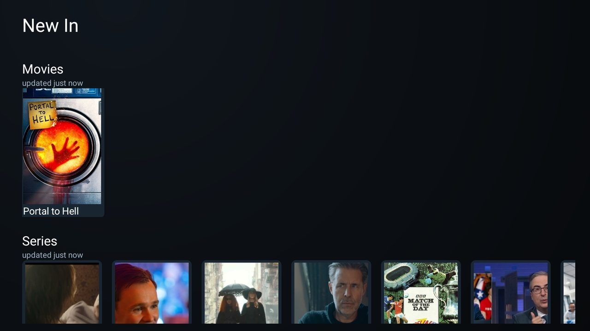

# New In

New In is an optional [Clean Your TV](../../README.md) module card and standalone Android TV app. It shows live fixtures from Game Day (opens Cricfy), OwnTV's Watch Next entries (opens the saved OwnTV link), Jellyfin's latest Movies and Series and continue-watching entries (opens Jellyfin), and Seerr requests with status badges (read-only; OK does nothing). Missing sources are hidden; previously fetched shelves stay visible offline with an age and error line.

## Set up

Build with JDK 17 and Android SDK 34: `./gradlew test assembleRelease`. Install `app/build/outputs/apk/release/app-release.apk` on the TV. Copy `settings.example.txt` to `settings.txt` beside this README and fill in your own URLs, API keys, and Jellyfin user ID. `settings.txt` is ignored by git and must never be committed. The keys are `jellyfin_url`, `jellyfin_key`, `jellyfin_user`, `jellyseerr_url`, `jellyseerr_key`, and optional `live_sports_app` (defaults to `com.cricfytv.sports`). URLs can be HTTP on your private LAN.

With the repository's `tools/venv` set up, run `./setup.sh` with `TV_HOST` set to your TV's address, or run `setup.ps1 -TvHost <tv address>` in PowerShell. Both send the file privately through `tools/tv.py` and grant the TV listings permission. Reopen New In to refresh. Game Day, OwnTV, Jellyfin and Cricfy are separate apps; only installed apps can be opened. No Jellyfin item deep link is available on the installed Android TV build, so cards open Jellyfin itself. Seerr cards do not place requests.

## Permissions

- `INTERNET` — network access to fetch Jellyfin and Seerr rows and posters.
- `READ_TV_LISTINGS` — read TV listings for OwnTV's Watch Next entries; granted by the setup script.

New In has no background service, ads, or telemetry. Posters and last-good responses are cached locally up to approximately 20 MB.
