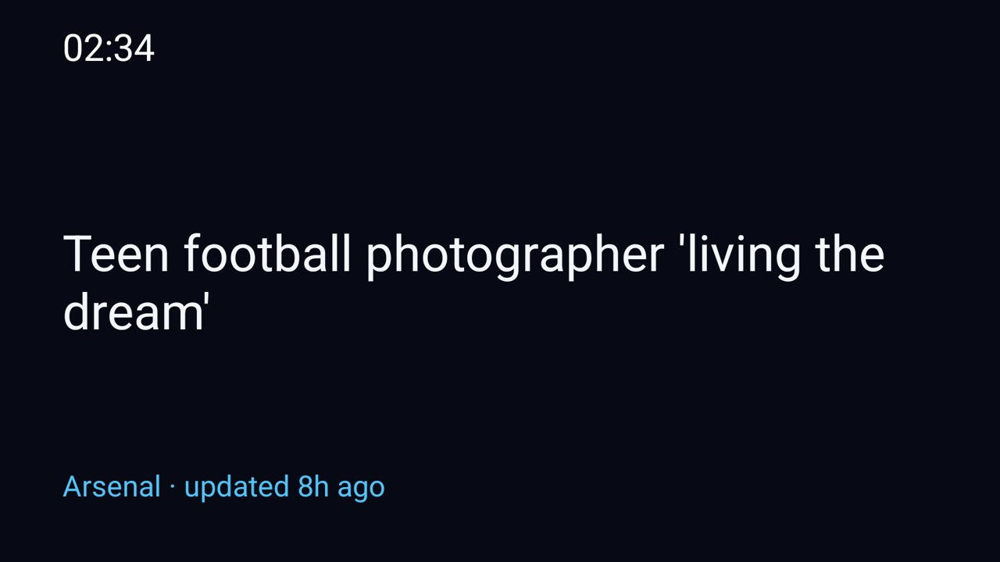

# News

News is an optional Clean Your TV Daydream screensaver that presents a single persistent dashboard layout combining headline news, supporting article slots, Seerr upcoming releases, a match-day strip, and a remote-revealed quick launcher row. Previously fetched feeds, posters, and match data remain available offline from cache.

## Set up

Build with JDK 17 and Android SDK 34: `./gradlew test assembleRelease`. Install `app/build/outputs/apk/release/app-release.apk` on the TV. Copy `settings.example.txt` to `settings.txt` and fill in your Seerr URL, API key, and optional launcher app targets, or leave them blank to show news only. `settings.txt` is ignored by git. Run `./setup.sh` with `TV_HOST` set, or `setup.ps1 -TvHost <tv address>` in PowerShell, to send settings privately.

| Setting | Purpose |
|---|---|
| `jellyseerr_url`, `jellyseerr_key` | Optional Seerr connection for upcoming films and series |
| `game_day` | Optional match-day provider / team configuration |
| `refresh_minutes` | Optional background refresh interval in minutes (default 15, clamped ≥1) |
| `feed1`, `feed2`, … | RSS URL and display name separated by `|`; defaults to configured default feeds when settings are absent |
| `row1`, `row2`, … | Optional launcher row package name and optional display label separated by `|` (e.g. `com.netflix.ninja|Netflix`) |

## Dashboard Layout & Behavior

- **Persistent Dashboard**: Replaces slide rotation with an integrated 1080p layout featuring a clock and refresh-status header, a prominent lead story, supporting content slots, and a bottom match-day strip.
- **Refresh & Freshness**: Refreshes data exclusively while the DreamService is visible and active. Stale or cached content is explicitly marked with freshness indicators.
- **Match-Day Strip**: Displays upcoming, live, or final match status. If the match provider is missing or unconfigured, it gracefully presents an unavailable/unconfigured state.
- **Launcher Row**: Hidden by default at rest. Any remote control keypress or directional input reveals the quick-launch app row (displaying only verified launchable targets), which automatically hides after ~10 seconds of idle inactivity.

## Screensaver

Select Settings → Device Preferences → Screen saver → News. The dream starts when the TV idles; it has no launcher tile. On TCL TVs the firmware's autostart gate must allow the dream service before the system can bind it; the setup scripts handle this with a one-time `appops set com.gathin.news AUTO_START allow`.

Tested on: TCL 65C6K, Android TV 14.

## Not Yet Verified on Device

*Note: Due to hardware testbed unavailability during this development cycle (`192.168.0.153` unreachable), physical TV verification remains pending. However, all core logic, parsing, layout formatting, lifecycle management, and target resolution are comprehensively covered by automated unit test suites:*
- `DashboardSlotsTest` / `DashboardLoaderTest` / `DashboardSnapshot` — mixed RSS/Seerr slot allocation and freshness handling.
- `GameDayReaderTest` — upcoming, live, final, empty, missing-provider, and exception states.
- `RefreshSchedulerTest` — periodic and visibility-gated background refresh scheduling.
- `LauncherTargetsTest` — resolving launchable apps and filtering non-launchable packages.
- `DashboardFormatTest` / `SlidesTest` — text formatting, truncation, and layout metrics.
- `FeedsTest` — RSS parsing and offline cache fallbacks.

**Device Checklist to complete upon deployment:**
1. Verify fresh mixed RSS and Seerr snapshot rendering on 1080p output.
2. Verify behavior when a single RSS feed fails while others successfully refresh (cached headlines shown with stale indicators).
3. Verify Game Day match states (upcoming, live, final, empty, unconfigured provider).
4. Verify remote input reveals the launcher row, focus traversal works smoothly across items, and it hides after ~10 seconds idle.
5. Verify DreamService detach/reattach lifecycle avoids stale callbacks or overlapping loader threads.
6. Verify 1080p legibility (font sizing, contrast, poster scaling, match strip clarity, and absence of layout shift during refresh).

## Permissions

- `INTERNET` — fetch RSS headlines, Seerr upcoming releases, posters, and match data.
- `READ_TV_LISTINGS` — declared in the screensaver manifest; the dream does not read listings or require a grant.
- The exported settings provider requires `WRITE_SECURE_SETTINGS` from its caller to write private settings; the app does not request this permission.

The background DreamService runs only while the screensaver is active. No ads or telemetry.
